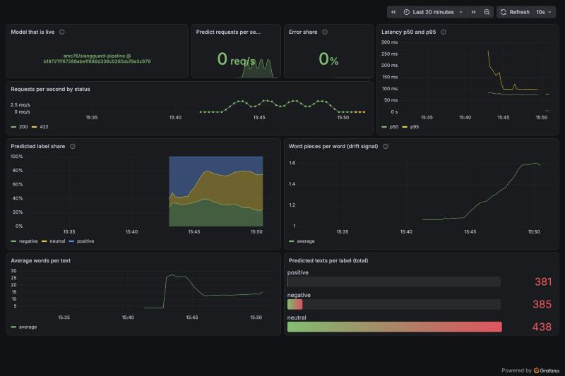

# SlangGuard

A continual-learning MLOps system for Indonesian sentiment analysis.
When the language in new data changes (drift), the system retrains the model
with LoRA + replay, so it learns new slang without forgetting old data.

## Status

Done: data pipeline (DVC), baselines, the LoRA + replay method, a prediction API with Docker and
CI, the retraining pipeline (drift check, Kaggle GPU, promotion rule, registry, API switch) run end to
end on real services, monitoring with Prometheus and Grafana, and a public demo.

**Try it:** <https://huggingface.co/spaces/amc76/slangguard-demo>. The model runs in your browser, so
nothing you type is sent anywhere.
See [docs/design.md](docs/design.md) for the full design and roadmap.

## Tech stack

**Modeling**

  

**Data and experiments**

     

**Drift and pipeline**

 

**Serving**

  

**Quality and tooling**

     

**Monitoring**

 

**Demo**

   

Badges are made with [shields.io](https://shields.io) in the style of
[ileriayo/markdown-badges](https://github.com/ileriayo/markdown-badges).

## Results

Language change is **simulated**: four periods, from formal reviews to tweets that are
increasingly rewritten with slang. P3 and P4 are not real future language.
Mean over 3 seeds, macro-F1 on the test sets of all four periods after the last update:

| Method | AvgF1 | P1 (oldest period) | Training time of the last update |
| --- | --- | --- | --- |
| Naive fine-tune (new data only) | 0.677 | 0.759 | 32 s |
| Full retrain on all data | 0.724 | 0.925 | 328 s |
| **LoRA + 5% replay** | **0.725** | **0.900** | **29 s** |

Details and limits: [docs/results.md](docs/results.md) and [docs/baselines.md](docs/baselines.md).
The trained adapter is on Hugging Face:
[amc76/slangguard-indobert-lora-replay](https://huggingface.co/amc76/slangguard-indobert-lora-replay).

## Run the API

You need Docker. The first start downloads the model (about 480 MB, a few minutes), and later
starts take seconds.

```bash
docker compose up
```

Then, in another terminal:

```bash
curl -X POST localhost:8000/predict -H 'Content-Type: application/json' \
  -d '{"texts": ["makanannya enak banget, pelayanannya ramah", "parah sih, lama banget nunggunya"]}'
```

The answer has a label and the three class probabilities for each text, in the same order.
Interactive documentation is at <http://localhost:8000/docs>, and `GET /health` shows the model
version. Stop with `docker compose down`. Without Docker:
`uv run uvicorn src.serving.app:create_default_app --factory`.

One sentence takes about 60 ms in Docker on a laptop CPU, and the container uses about 1 GB.

## Monitoring

The API reports request counts, latency, the mix of predicted labels and word pieces per word (a
live sign that slang is arriving). It is optional and does not start with the API:

```bash
docker compose --profile monitoring up    # Grafana at http://localhost:3000, Prometheus at :9090
```



Details, the metrics and what was measured: [docs/monitoring.md](docs/monitoring.md).

## The demo

The page at <https://huggingface.co/spaces/amc76/slangguard-demo> loads an 8-bit version of the model
into your browser (about 125 MB on the first visit). It is a static page because Gradio Spaces now
need a paid plan. How it was built and checked against the Python model: [docs/demo.md](docs/demo.md).
To try the model with Gradio on your own computer: `PYTHONPATH=. uv run python demo/app.py`.

## Retraining pipeline

New text is checked for drift with Evidently. If the language changed, a Prefect flow trains a copy
of the current model on a Kaggle GPU, compares it with the current one on validation sets, and
switches the API only if it passes. How it works, how it was calibrated, and what has been run
for real: [docs/pipeline.md](docs/pipeline.md).

## Develop

```bash
uv sync                  # all dependencies
uv run ruff check . && uv run ruff format --check . && uv run pytest
```

Training runs on Kaggle (see `notebooks/`), and the data is tracked with DVC.
