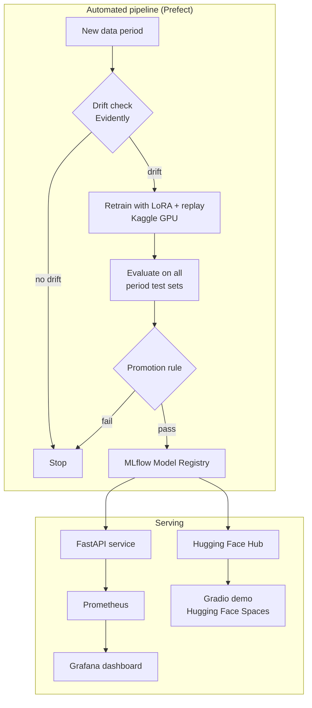

# SlangGuard Design

## 1. Problem

Slang on Indonesian social media changes fast, so a sentiment model gets old quickly.
There are two simple ways to update it, and both have a cost:

- **Train only on new data.** The model forgets old data. Accuracy on old text drops
  sharply. This is called *catastrophic forgetting*.
- **Retrain on all data from scratch.** The model does not forget, but training gets
  more expensive with every new period.

SlangGuard looks for a middle path: update the model cheaply, without forgetting.

## 2. Questions

The project answers three questions:

1. Can the system detect on its own when new data is too different from old data (drift)?
2. Can the model be updated cheaply with LoRA + replay, without forgetting old data?
3. How close is the result to a full retrain, and how much training time does it save?

## 3. Scope

| Category | What is included |
| --- | --- |
| **MVP** | 3-class sentiment (positive, neutral, negative). Data split into 3 to 4 periods. Automatic drift detection. Retraining with LoRA + replay. A new model goes live only if it passes evaluation. Prediction API. Monitoring dashboard. Online demo. |
| **Extra, if time allows** | Comparison with other methods such as EWC. Deployment on local Kubernetes (kind). Automatic slang dictionary from new words. Real drift from recent social media text. |
| **Out of scope** | Large-scale social media scraping. Large LLMs. Paid cloud servers. Mobile app. |

## 4. Architecture

The system has two parts: an automated pipeline that updates the model, and a serving
part that answers prediction requests.

If there is no drift, the pipeline stops after the drift check.

## 5. Tech stack

Every tool is free. The only real limits are the weekly Kaggle GPU quota and laptop RAM.

| Part | Tools | Runs on |
| --- | --- | --- |
| Code and data versioning | Git, GitHub, DVC | Laptop + GitHub |
| Training | PyTorch, Hugging Face Transformers, PEFT (LoRA) | Kaggle Notebooks (GPU) |
| Experiment tracking | MLflow, hosted on DagsHub (free), written to directly from Kaggle | DagsHub |
| Model registry | MLflow | Laptop (Docker), from milestone 3 |
| Drift detection | Evidently AI | Laptop |
| Pipeline orchestration | Prefect | Laptop |
| Prediction API | FastAPI, Uvicorn, ONNX Runtime (optional) | Laptop (Docker) |
| Monitoring | Prometheus, Grafana | Laptop (Docker Compose) |
| Testing and CI | pytest, Ruff, GitHub Actions | GitHub |
| Demo | Gradio on Hugging Face Spaces | Free cloud |
| Model storage | Hugging Face Hub | Free cloud |

Training runs on Kaggle, not on the laptop. The laptop only runs the services that are
needed at the moment, to keep memory use low.

The Kaggle environment checked by [notebooks/00_gpu_check.ipynb](../notebooks/00_gpu_check.ipynb):

| Item | Version |
| --- | --- |
| Python | 3.13.16 |
| PyTorch | 2.11.0 (CUDA 13.0) |
| GPU | 2x Tesla T4 |

The local project uses the same Python minor version (3.13), so code tested on the
laptop behaves the same on Kaggle.

## 6. Data and drift scenario

Public Indonesian sentiment datasets rarely have dates. So language change is
**simulated**: each period uses text that is more informal than the one before.
The README states this clearly.

### Datasets

The full survey, with licenses and the reasons for each choice, is in [data.md](data.md).

- **SmSA (IndoNLU):** formal reviews and comments, 3 sentiment classes.
- **Indonesian Sentiment Twitter Dataset (IDSA):** informal tweets, 3 sentiment classes.
- **Colloquial Indonesian Lexicon:** slang-to-formal word pairs, used in reverse to rewrite
  text into heavier slang.

IDSA and the lexicon have no stated license, so their text is never published. They are
downloaded from the original source inside the pipeline, and the DVC remote is private.

### Periods

| Period | Data | Language style |
| --- | --- | --- |
| P1 | SmSA | Formal |
| P2 | IDSA, part A | Real informal tweets |
| P3 | IDSA, part B, rewritten with the lexicon at a moderate rate | Heavier slang |
| P4 | IDSA, part C, rewritten at a high rate plus made-up new words | Simulated future slang |

The three IDSA parts share no tweets. Each period has its own train, validation, and test split. Test sets from old periods
are always kept, to measure forgetting. They are never used for training or tuning.

All periods use the same 3 labels. If a dataset has only 2 classes, it is dropped or
mapped with care, and the decision is written down.

## 7. Methods

LoRA + replay is the main method. It is compared with two baselines, so the claim
"it does not forget" is backed by numbers.

| Method | How it works | Role |
| --- | --- | --- |
| **Naive fine-tune** | Train only on the new period | Lower baseline: shows forgetting |
| **Full retrain** | Train from scratch on all periods so far | Upper baseline: best accuracy, highest cost |
| **LoRA + replay** | Train only LoRA adapters, on new data plus a small sample of old data (replay buffer) | Proposed method |
| **EWC (optional)** | Penalize changes to weights that matter for old periods | Extra comparison |

- **Base model:** IndoBERT base (`indobenchmark/indobert-base-p1`). If Kaggle GPU time is
  too short, a smaller model is used.
- **Replay buffer size:** start at 5% of old data per period, then compare 1%, 5%, and 10%.

## 8. Metrics

Let $a_{t,i}$ be the macro-F1 on the test set of period $i$ after the model has been
trained up to period $t$. Let $T$ be the number of periods.

**Average F1:** mean performance over all periods after the last period.

$$
\text{AvgF1} = \frac{1}{T} \sum_{i=1}^{T} a_{T,i}
$$

**Forgetting:** how far performance on old periods fell from its best value.
Lower is better.

$$
\text{Forgetting} = \frac{1}{T-1} \sum_{i=1}^{T-1} \left( \max_{t < T} a_{t,i} - a_{T,i} \right)
$$

### Targets

These are first estimates, not results. They will be revised after the baselines are done.

| Metric | Target |
| --- | --- |
| AvgF1 of LoRA + replay | At most 3 points below full retrain |
| Forgetting of LoRA + replay | Less than half of naive fine-tune |
| Training time per update | Less than half of full retrain |
| API latency (CPU, one sentence) | Under 200 ms |
| Automated pipeline | From detected drift to a live new model with no manual step |

## 9. Roadmap

| Milestone | Outcome | Done when |
| --- | --- | --- |
| 0. Setup | Repo, tooling, accounts | Repo skeleton is on GitHub and a Kaggle notebook can use a GPU |
| 1. Data | P1 to P4 splits tracked with DVC, plus data analysis | `dvc pull` gives the same data on another machine, and style differences between periods are visible |
| 2. Baselines | Naive fine-tune and full retrain over P1 to P4, logged in MLflow | Naive fine-tune shows P1 performance dropping after P3 and P4 |
| 3. LoRA + replay | Buffer size experiments, comparison table and chart | Results for all 3 methods, best model on Hugging Face Hub |
| 4. API and CI | FastAPI service in Docker, tests and GitHub Actions | `docker compose up` starts the API, and CI passes on every push |
| 5. Drift and pipeline | Evidently report, Prefect flow, promotion rule | Adding P4 data triggers the whole flow up to the API serving the new model |
| 6. Monitoring and demo | Prometheus metrics, Grafana dashboard, Gradio demo, docs | Anyone can try the demo and run the project from the README |

## 10. Risks

| Risk | Impact | Mitigation |
| --- | --- | --- |
| Kaggle GPU quota runs out | Training is delayed | Smaller model, fewer epochs, checkpoint every epoch |
| Kaggle session disconnects | Training results are lost | Metrics go to MLflow on DagsHub as they are produced, and each run also writes a local `outputs/*.json` copy |
| Laptop RAM is not enough | Docker is slow or crashes | Start only the services in use, limit memory per container |
| Drift between periods is too small | Forgetting does not show | Make P4 more different with the slang dictionary |
| Labels differ across datasets | Unfair evaluation | One shared 3-class scheme, manual check of random samples |
| Dataset license is unclear | Data cannot be shared | Check licenses first, never re-upload raw data that is not allowed |
