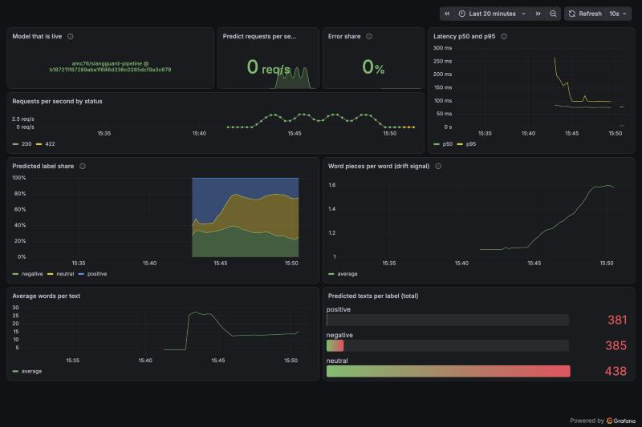

# Monitoring

The API reports numbers about itself to Prometheus, and Grafana draws them. The goal is to see two
things: whether the service is healthy, and whether the text it receives is changing, which is the
same drift the pipeline looks for, but live.



## Run it

Monitoring is optional and does not start with the API:

```bash
docker compose --profile monitoring up
```

Grafana is at <http://localhost:3000> (the dashboard is "SlangGuard API", and viewing needs no login)
and Prometheus is at <http://localhost:9090>. Both are bound to this computer only. To fill the
dashboard with traffic from one period of the data (needs `dvc pull`):

```bash
uv run python -m src.serving.traffic --period p2 --requests 300
```

That tool sends the texts only to `localhost`, because the dataset text may not be shared.
Run it with `--period p4` afterwards and watch the drift panel move.

## What the API reports

Only counts and sizes. The text that users send is never stored or exported (a test checks this).

| Metric | Type | What it shows |
| --- | --- | --- |
| `slangguard_requests_total{endpoint,status}` | counter | traffic and errors |
| `slangguard_request_seconds{endpoint}` | histogram | latency |
| `slangguard_predictions_total{label}` | counter | the mix of predicted labels |
| `slangguard_text_words` | histogram | words per text |
| `slangguard_pieces_per_word` | histogram | the live drift signal (below) |
| `slangguard_model_info{adapter_repo,adapter_revision}` | gauge | which model is live |

The endpoint label is the route template, not the raw URL, so random URLs cannot create an endless
number of series.

## The drift signal

Words that the vocabulary does not know are split into more word pieces. So the average number of
pieces per word rises when slang arrives. The share of `[UNK]` tokens would not show this: it is
0.0000 in every period, because WordPiece never gives up on a word.

Measured from Prometheus, with 300 validation texts of each period sent in turn:

| Traffic | Pieces per word | Words per text | Share negative / neutral / positive |
| --- | --- | --- | --- |
| P1 (reviews) | 1.081 | 26.6 | 0.32 / 0.11 / 0.58 |
| P2 (tweets) | 1.232 | 12.4 | 0.39 / 0.41 / 0.21 |
| P3 (light slang) | 1.351 | 13.1 | 0.31 / 0.42 / 0.27 |
| P4 (heavy slang) | 1.589 | 13.5 | 0.27 / 0.52 / 0.21 |

These match what was measured offline on the same data (1.08, 1.21, 1.33 and 1.56). The label share
also shifts, because P1 has few neutral texts and the tweets have many. Each number is an average,
so a few odd texts do not move it much, and it needs a few hundred texts to be steady.
The pipeline's drift check (see [pipeline.md](pipeline.md)) uses a different method, a classifier
that tells old text from new. This panel is a cheap live signal. It does not trigger anything.

## Cost

| Container | Memory in use | Limit |
| --- | --- | --- |
| API | 887 MiB | 2 GiB |
| Prometheus | 43 MiB | 256 MiB |
| Grafana | 307 MiB | 384 MiB |

Grafana needs more than the 256 MiB first planned. Prometheus keeps 7 days of data.

## Limits

- No alerts. A person has to look at the dashboard.
- One API instance, and no authentication on Grafana for viewing (it is only reachable from this
  computer). Do not expose these ports to a network as they are.
- Pieces per word depends on the tokenizer's vocabulary, so it must be recalibrated if the base
  model changes.
