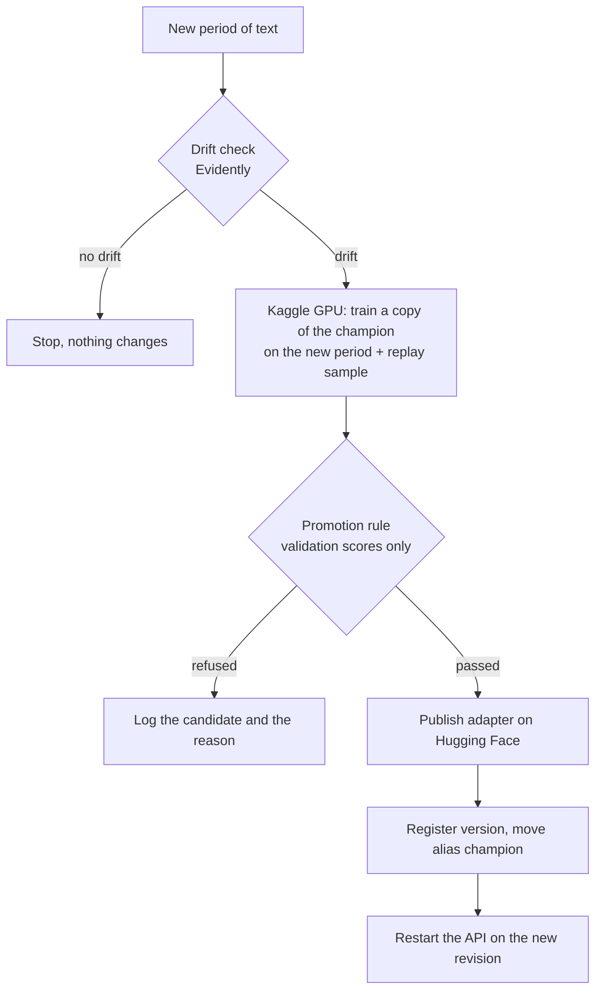

# The retraining pipeline

When a new period of text arrives, the pipeline decides whether the language has changed, and if it
has, trains a new model, checks it against the current one, and switches the API only when the new
model passes. The code is in `src/pipelines/`, `src/drift/` and `src/training/update.py`, and the
settings are in `configs/pipeline.yaml`.



## Status

The pipeline has run end to end on real services: Kaggle GPU, DagsHub, Hugging Face and Docker.
The results of those runs are in the next section. The only part not shown live is the early stop
when there is no drift (see "What was not shown live").

## First real runs (9 Nov 2026)

**Bootstrap, P1 to P3.** The first champion (registry version 1, Hugging Face commit `13ac8a98`)
scored 0.892, 0.667, 0.659 and 0.566 on the test sets of P1 to P4. The same method in the Week 3
experiments (seed 42, after step 3) scored 0.883, 0.673, 0.638 and 0.576, so the pipeline
reproduces the experiment to within about 0.02 per period. The runs are not identical because each
update starts from a new seed.

**Update with P4.** The drift check gave a score of 0.984 and the flow went on. The Kaggle job
started from champion version 1. The candidate was compared with it on the validation sets, which is
what the rule uses:

| Period | Champion v1 | Candidate | Change |
| --- | --- | --- | --- |
| P1 | 0.882 | 0.886 | +0.004 |
| P2 | 0.667 | 0.657 | -0.010 |
| P3 | 0.613 | 0.614 | +0.001 |
| **P4 (new)** | **0.611** | **0.693** | **+0.082** |

The rule passed it (better on P4, biggest drop on an older period about 0.01, limit 0.02). The
candidate became version 2 (Hugging Face commit `b187211f`), the alias `champion` moved, and the API
restarted on the new revision. Its test scores are 0.902, 0.681, 0.687 and 0.657, close to the
Week 3 result for the same method (0.905, 0.687, 0.689, 0.645).

**Time.** The whole flow took 45 minutes from the command to a live API, with no manual step.
Little of that is computing:

| Stage | Time |
| --- | --- |
| Drift check | 9 s |
| Kaggle stage (upload data, queue, job, download) | about 26 min, of which the GPU session was 2.4 min and the training itself 28 s |
| Decision, upload, registry, restart | about 19 min, mostly waiting for DagsHub (a model version takes about a minute to create, and one request had to be retried after a reset connection) |

**What was not shown live.** The early stop when there is no drift was not run on the real
services. The periods end at P4 and the champion has now learned P4, so there is no next period to
test it on. That path is covered by a flow test, which uses real Evidently on synthetic text and checks that no
job is started, and the threshold was calibrated on the real period data (see below).

**Problems the real runs found**, all fixed and covered by tests where a test can see them:

- The Kaggle job image was a CPU image, so the job had no GPU. The image has to come from
  `kaggle-gpu-images`. Asking for an accelerator with `--accelerator` was not the cause.
- A champion loaded from disk was scored while still on the CPU, which failed on a GPU. It could only
  be reproduced on an accelerator, so a test now runs on MPS or CUDA when one exists.
- DagsHub answers "no champion yet" with an error that has no message, so the registry reads the
  model's list of aliases instead of the error text.
- Prefect 3.8 does not start with a new FastAPI, and Prefect 3.9 needs FastAPI 0.150 or older.
  Evidently does not import with pandas 3.

## The steps

**1. Drift check** (`src/drift/detect.py`). Evidently trains a small classifier to tell the text of
the newest period the champion learned from the new text. Its ROC AUC is the drift score: 0.5 means
the two look the same, 1 means they are easy to tell apart. It needs no labels. Evidently's own flag
only says the difference is not luck, and with enough texts a tiny difference passes. So a period
counts as drifted only if that flag is set and the score is above a threshold of 0.60.
The threshold comes from controls on the period data, 5 random samples of 1,500 texts each:

| Compared | Mean AUC | Range | Flagged by Evidently |
| --- | --- | --- | --- |
| Same period, train against val (P2, P3, P4) | 0.49 to 0.52 | 0.48 to 0.54 | 0 of 5 each |
| P2 to P3 (light slang rewrite) | 0.663 | 0.65 to 0.69 | 5 of 5 |
| P1 to P2 (reviews to tweets) | 0.922 | 0.91 to 0.93 | 5 of 5 |
| P3 to P4 (heavy slang) | 0.976 | 0.97 to 0.98 | 5 of 5 |

The threshold sits between the highest control (0.543) and the smallest real change (0.648). The
periods are simulated, so on real text the numbers will differ and the threshold needs the same
check again.

**2. Update step** (`src/training/update.py`). It loads the champion adapter and scores it on the
validation and test sets of every period before any training. Then it trains a copy on the new
period plus the replay sample of the older ones (the same sample as in the experiments, rebuilt
from the seed, so it never has to be stored), keeps the best epoch by the validation score of the
new period, and scores the candidate on all validation and test sets. The champion's files are never
changed. On Kaggle this takes about 30 seconds of training for one period.

**3. Promotion rule** (`src/pipelines/promote.py`). The candidate must beat the champion on the
validation set of the new period, and no older period may lose more than 0.02 macro-F1 on its
validation set. Test sets are scored and logged but never decide anything. A refused candidate is
logged with the reason and is not registered.

**4. Registry** (`src/pipelines/registry.py`, MLflow on DagsHub). Every update is a run with its
scores, decision and adapter. Passing candidates become a model version, tagged with the Hugging
Face repo and revision, and the alias `champion` points to the version in use. **Promotion moves the
alias, and a rollback moves it back.**

**5. Switching the API** (`src/pipelines/deploy.py`). The flow writes the new repo and revision to
`champion.env`, recreates the container and waits until `/health` shows the new revision. The API is
down for about 10 seconds. If the switch fails after the alias moved, the flow says so, and
`--deploy-only` retries the switch.

## Running it

One-time setup: copy `.env.example` to `.env` and put the DagsHub token in it, log in to Hugging Face
(`uv run hf auth login`), and have the Kaggle token in `~/.kaggle/`. The code has to be committed and
pushed, because the Kaggle job clones it from GitHub.

```bash
uv run --env-file .env python -m src.pipelines.flow --bootstrap p3     # first champion, P1 to P3
uv run --env-file .env python -m src.pipelines.flow --new-period p4    # an update
uv run --env-file .env python -m src.pipelines.flow --deploy-only      # restart the API
```

Prefect needs no separate server: it starts a local one on the first run (about 15 seconds). To see
the runs in a browser, run `uv run prefect server start` in another terminal.

## The Kaggle job

The period files go to a private Kaggle dataset in the project owner's account, and the job is a
script kernel with a GPU (`src/pipelines/kaggle_body.py`). **The job holds no secret**: the code is
cloned from a public GitHub commit, the champion is downloaded from a public Hugging Face repo, and
the data comes from the private dataset. This avoids the problem of Kaggle dropping secrets on a
push from the command line. The job stops by itself when it finishes or fails. The Kaggle tool can
not cancel a job, so the pipeline gives up waiting after 45 minutes and says so, and a stuck job
has to be stopped on kaggle.com.

## Limits

- **The drift is simulated**, and the threshold is calibrated on that simulation.
- **The candidate's validation score for the new period is a little optimistic**, because the same
  validation set picked its best epoch. The champion has no such advantage. The rule still asks for
  a gain above zero, and the test scores are reported next to it.
- **A 2-point limit on forgetting is a choice**, and with validation sets of a few hundred texts a
  difference of that size can be noise.
- **Only the newest learned period is the drift reference.** Slow drift across many small steps
  would not be seen if each step is below the threshold.
- **One champion at a time**, no shadow deployment or gradual rollout, and the API restarts.
